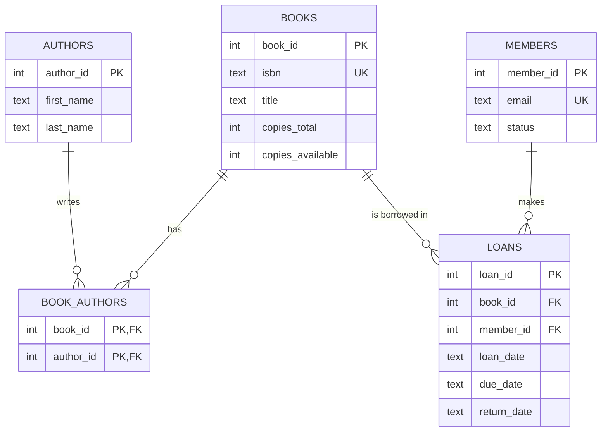

# Library Management Database

A small relational database (SQLite) for a library: books, authors, members and loans, with sample data and 14 analysis queries.

## Run it
```
python run.py
```
Builds `library.db` from `schema.sql` + `seed.sql`, then runs every query in `queries.sql` and prints the results. Python 3 only; no installs. To explore interactively, open `library.db` in any SQLite client.

## Files
| File | Purpose |
|---|---|
| `schema.sql` | Tables, keys, constraints, indexes, triggers, an overdue view |
| `seed.sql` | Invented data: 12 authors, 14 books, 10 members, 27 loans, plus UPDATE/DELETE examples |
| `queries.sql` | Joins, aggregates, LEFT JOIN, HAVING, view usage |
| `run.py` | Builds the DB and prints query output |

## Sample output

**Q1. Which books are overdue?**
```
loan_id  title                          member         due_date    days_overdue
-------  -----------------------------  -------------  ----------  ------------
21       Kafka on the Shore             Frank Okafor   2026-09-29  44
18       Pride and Prejudice            Alice Johnson  2026-10-04  39
19       The Handmaid's Tale            Bob Smith      2026-10-15  28
20       One Hundred Years of Solitude  David Lee      2026-10-24  19
26       Animal Farm                    Alice Johnson  2026-10-26  17
```
(Results depend on the date you run it; the figures above are as of 2026-11-13.)

**Q2. Who borrowed the most?**
```
member_id  member          total_loans
---------  --------------  -----------
1          Alice Johnson   6
2          Bob Smith       4
5          Eva Chen        4
3          Carla Martinez  3
7          Grace Patel     3
```

## Schema

- **authors** (`author_id` PK)
- **books** (`book_id` PK, `isbn` UNIQUE, copies_total/available with CHECKs)
- **book_authors**: junction table, composite PK, FKs to both (books can have co-authors)
- **members** (`member_id` PK, `email` UNIQUE, status CHECK)
- **loans** (`loan_id` PK, FKs to books and members; `return_date` NULL means still out)

Foreign keys: deleting a member or book with loan history is blocked (`RESTRICT`); deleting a book removes its `book_authors` rows (`CASCADE`).
Triggers keep `books.copies_available` in sync when a loan is opened or returned.

## Key queries
- **Overdue books** (Q1): `return_date IS NULL AND due_date < date('now')`
- **Who borrowed the most** (Q2): `JOIN` + `GROUP BY` + `ORDER BY COUNT(*) DESC`
- Also: popular books/authors/genres, late fees, never-borrowed members, monthly volume.

## Notes
- "Overdue" is relative to today's date (`date('now')`), and the sample due dates are set around November 2026. If you run this much later, more loans will show as overdue; adjust the dates in `seed.sql` if you want different results.
- SQL dialect is SQLite (`julianday`, `strftime`, `printf`). MySQL/Postgres would need small changes, e.g. `DATEDIFF` / `CURRENT_DATE`, and `AUTO_INCREMENT` / `SERIAL`.
